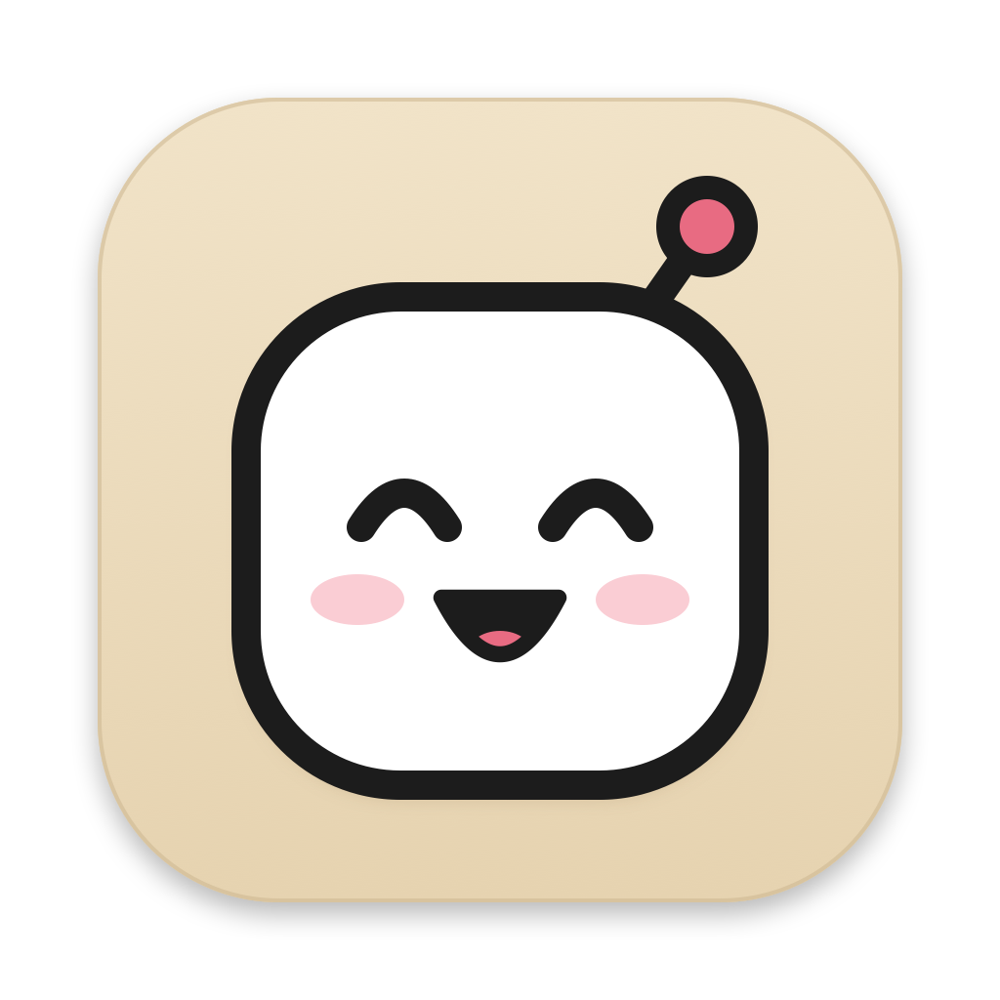
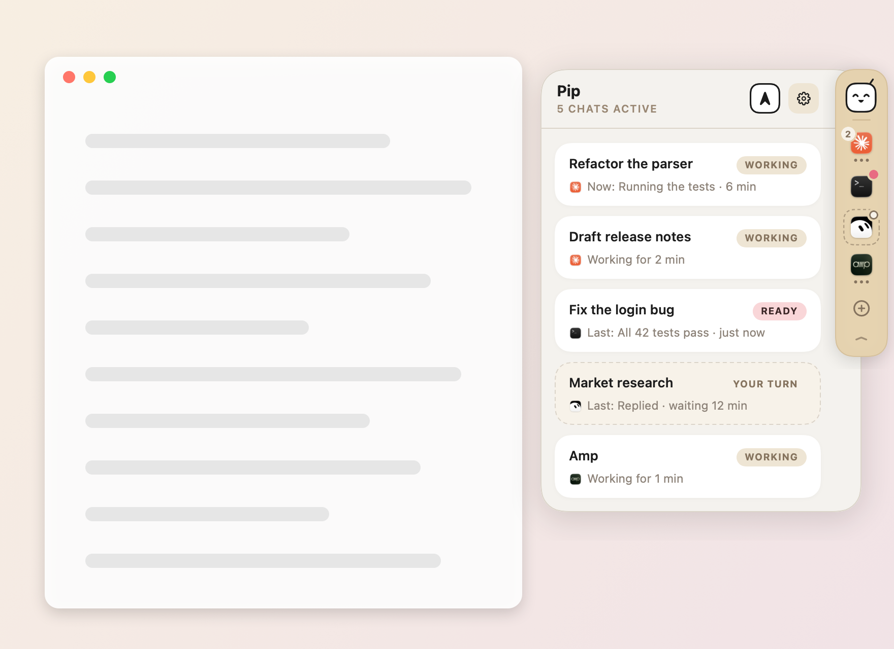
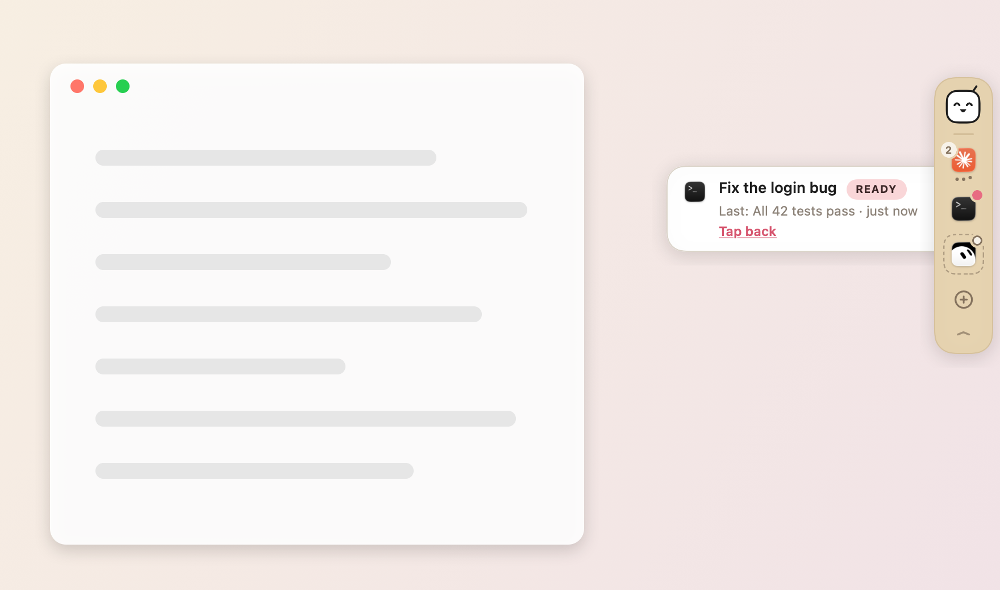
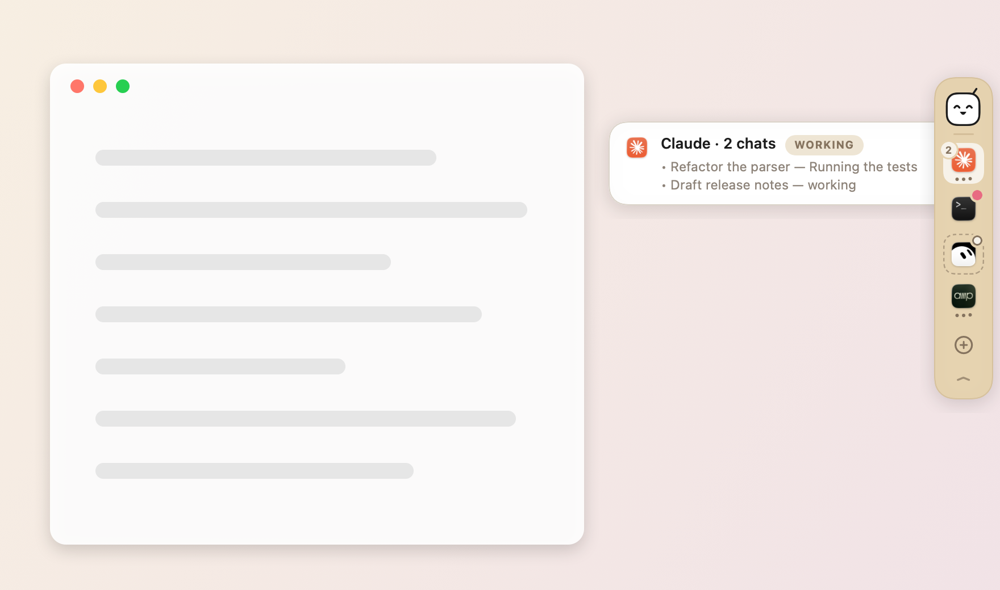

<p align="center">
  
</p>

<h1 align="center">Pip</h1>

<p align="center">
  <b>Never lose track of your AI agents.</b><br>
  A tiny Mac sidebar that tells you when Claude, Codex, Grok and your other agents finish, and takes you straight back to the chat.
</p>

<p align="center">
  <a href="https://github.com/kingcloudsister/pip-buddy/releases/latest/download/Pip.zip"><b>⬇ Download for Mac</b></a>
  &nbsp;·&nbsp; macOS 14 or later &nbsp;·&nbsp; Apple silicon &amp; Intel &nbsp;·&nbsp; Free &amp; open source
</p>

<p align="center">
  
</p>

## Why

You give an agent a task, switch to something else while it works, and forget to go back. Or you glance at its answer, switch away, and lose the thread. With Claude, Codex, Grok and a terminal agent all running at once, keeping track turns into a job of its own.

Pip keeps track for you. It sits quietly on the edge of your screen, notices on its own which apps have an agent at work, pings you the moment one finishes, and keeps a finished chat on the strip until you've actually picked it back up.

## What it does

<p align="center">
  
  
</p>

- **Finds your agents on its own:** Claude, ChatGPT, Cursor, browser agents, and terminal agents like Claude Code, Codex and Gemini CLI. No setup.
- **Tells you when one is done:** a card slides out with the chat's name and the last thing it did. Click **Tap back** to land right in that chat.
- **Shows what each one is doing:** hover a tile for every running chat and its current step ("Now: Running the tests · 6 min").
- **Doesn't let you forget:** when an agent asks you something, it stays as **your turn** until you answer, with one gentle nudge. Finished tasks you've seen just clear.
- **New messages too:** add Beeper, Slack, WeChat or Discord and see their unread count, from the Dock badge only.
- **Stays out of the way:** a slim strip on the left, right or top edge, or folded down to just its face.
- **Private:** everything stays on your Mac. See [Privacy](#privacy).

The face at the top sleeps when nothing runs, watches while something works, and smiles when something is done. Click it for the panel. Tiles show every open agent app with its status: hopping dots for working, a number for several chats at once, a pink dot for ready, a dashed outline for your turn.

## Download and install

1. Download **Pip.zip** from the [latest release](../../releases/latest) and unzip it.
2. Move **Pip.app** into your **Applications** folder.
3. Open it. Pip isn't from the App Store, so macOS stops it the first time:
   - Open **System Settings → Privacy & Security**, scroll down, and click **Open Anyway** next to the message about Pip.
   - Or run this once in Terminal: `xattr -dr com.apple.quarantine /Applications/Pip.app`
4. Allow Pip in **System Settings → Privacy & Security → Accessibility**. That's how it sees whether a chat is still working. See [Privacy](#privacy) for exactly what it reads.

Needs macOS 14 or later, on Apple silicon or Intel.

### Updates

Pip checks this repo for a new release when it starts and every few hours. When there is one, an **↓** tile appears on the strip. Click it, and Pip downloads the update, checks it's signed with Pip's release key, installs it, and restarts. Your settings and Accessibility permission stay as they are.

Right-click Pip for **Check for Updates…**, or to turn automatic checks off.

## Ready, done, or your turn

- **Ready** (pink dot): an agent finished and you haven't looked yet. A quick glance doesn't count.
- **Done:** once you've spent about 15 seconds on it, a finished task leaves the strip. Nothing to reply to, so no reminders.
- **Your turn** (dashed tile, hollow ring): the agent asked you something, like a question, an approval ("Allow / Deny", "Do you want to proceed?"), or a Grok bot waiting on your answer. That stays until the agent runs again, with one reminder after 10 minutes away. Right-click → **Done with This** to let it go.

## Messages

Messaging apps (Beeper, Slack, WeChat, Discord, WhatsApp, Messages, Telegram) are watched as soon as they're open. Their tile shows a pink unread count when new messages arrive, and a card pops up unless you're already in that app. If an app never shows a count, check that its Dock badge is on (System Settings → Notifications → the app → Badge application icon). Pip reads only the number on the app's Dock icon, never anything inside the app.

## Finding agents on its own

You don't have to add apps. Every few seconds Pip glances at one or two running apps it doesn't watch yet, taking turns, and looks for an agent at work:

- **Apps and browsers:** a short **Stop** / **Stop generating** / **Interrupt** button, or a chat marked **Running**.
- **Terminals** (Terminal, iTerm2, Ghostty, Warp, kitty and others): an agent's busy line such as **"esc to interrupt"** or **"esc to cancel"** (Claude Code, Codex, Gemini CLI). Each terminal window with a working agent gets its own card, named after the task in the window title, and clicking it brings that window forward.

When it finds one, that app joins the strip and shows up whenever something is working. Pip sees windows on every desktop, including full-screen apps. Music, video, system apps and Xcode are skipped, since their "Stop" means something else. Right-click an app → **Don't Watch This App** to keep it out for good, or turn off **Find Agents Automatically** in the menu.

## How it knows a chat is done

Every 1.5 seconds Pip looks at the apps you track. Chat apps show a **Stop** button while they generate; when it disappears, the chat is done. A new number on an app's Dock badge counts too. Apps that list their chats with a status, like the Claude app's sidebar ("Fix the login bug · Running"), are followed chat by chat.

**Grok Bot** runs its bots remotely, so Pip follows them through Grok Bot's own local list of bots, even with its window closed: a bot is working while your newest message has no reply yet, and it's ready when a reply arrives. If a bot replies more than once to one task, each reply pops a card.

If an app never shows as working, right-click Pip → **Copy Detection Report** while it generates, or write the report to a file:

```sh
open -n -W /Applications/Pip.app --args --report ~/Desktop/pip-report.txt --tree
```

## Hooks for scripts and CLI agents

Anything on your Mac can report to Pip:

```sh
curl -s "http://127.0.0.1:47321/working?app=My%20Agent&open=com.apple.Terminal"
curl -s "http://127.0.0.1:47321/done?app=My%20Agent&note=Tests%20pass&open=com.apple.Terminal"
```

`app` names the tile, `open` is the app to bring forward on click, `note` shows on the card. Add `&ask=1` to `/done` when the agent is waiting on an answer, so it stays as "your turn". `/idle` clears it.

## Privacy

Everything Pip knows stays on your Mac.

- **Messaging apps:** only the unread number on their Dock icon. Pip never looks inside them, and never searches them for agents.
- **What it reads:** with the Accessibility permission, the window titles, button labels and chat names of the apps you track, plus Dock badges. To find agents it also glances at other running apps' buttons, and at the text on screen in terminal windows, only to look for a busy line like "esc to interrupt"; nothing from it is kept. To see windows on other desktops it uses the same window lookup as window-switcher apps. For Grok Bot, the bot names, unread counts and message IDs in Grok Bot's local list (never the messages, and never its saved secrets). Not the messages themselves, in any app.
- **What it presses:** only a chat's row in an app's sidebar (and Claude's Chat/Code switch), and only when you click that chat in Pip. It never types.
- **What it stores:** your app list, its position and settings (in its preferences), and a log of state changes at `~/Library/Logs/Pip.log` (app and chat names, no message text). None of it is ever uploaded.
- **What goes over the internet:** only the update check, a plain request to GitHub for this repo's latest release, and the download when you install one. No account, no tracking. Turn it off in the right-click menu.
- **The hook** listens on 127.0.0.1 only and refuses requests from web browsers, so websites can't fake a "done".

## Build it yourself

Needs Xcode or the Command Line Tools:

```sh
./make-app.sh
cp -R build/Pip.app /Applications/
```

A copy you build yourself is signed ad-hoc, so it can't install release updates (they're checked against Pip's release key), and macOS asks for Accessibility again after each rebuild. To publish releases, see [RELEASING.md](RELEASING.md).

## License

[MIT](LICENSE). The name "Pip" and its icon are not part of the license grant.
